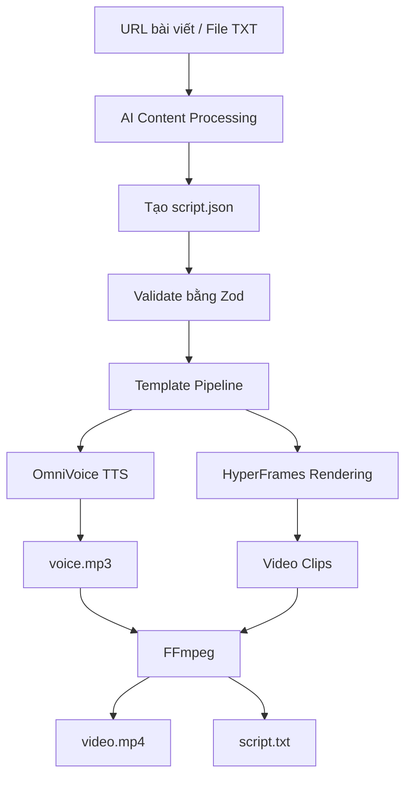

 
<div align="center">


# AI AUTO GENERATE VIDEO

### AI-Powered Automated Video Generation

**Biến bài viết tiếng Việt thành video ngắn chuyên nghiệp bằng AI.**

Tự động hóa toàn bộ quy trình: phân tích nội dung, viết kịch bản, chuyển văn bản thành giọng nói, thiết kế hình ảnh, hiệu ứng âm thanh và xuất video.

[](https://github.com/datdevl)
[](https://nodejs.org/)
[](https://www.typescriptlang.org/)
[](https://www.npmjs.com/package/hyperframes)
[](LICENSE)

**Developed by  AI CODING**

</div>

---

## 1. Giới thiệu

**AI Auto Generate Video** là dự án tự động hóa quá trình sản xuất video ngắn từ nội dung văn bản bằng cách kết hợp trí tuệ nhân tạo (AI) và các công nghệ xử lý đa phương tiện.

Thay vì phải tự viết kịch bản, thu âm, dựng cảnh và chỉnh sửa video thủ công, hệ thống cho phép người dùng cung cấp một đường dẫn bài viết hoặc tệp văn bản. Pipeline sẽ xử lý các công đoạn còn lại và tạo ra video hoàn chỉnh.

### Mục tiêu dự án

- Tự động hóa quy trình sản xuất video bằng AI.
- Chuyển đổi nội dung tiếng Việt thành video ngắn.
- Tối ưu thời gian sản xuất nội dung.
- Xây dựng hệ thống template video có thể mở rộng.
- Tạo ra sản phẩm phù hợp với TikTok, YouTube Shorts và Facebook Reels.

## 2. Tính năng chính

| Tính năng | Mô tả |
|---|---|
| AI Content Processing | Tiếp nhận và xử lý nội dung từ URL hoặc TXT |
| AI Script Generation | Xây dựng kịch bản video theo từng phân cảnh |
| Text-to-Speech | Chuyển văn bản thành giọng đọc bằng OmniVoice |
| Video Templates | Hệ thống template thiết kế video |
| Sound Effects | Tự động lựa chọn hiệu ứng âm thanh |
| Video Rendering | Render video bằng HyperFrames |
| Audio Processing | Ghép giọng đọc và hiệu ứng âm thanh |
| Automatic Export | Xuất video MP4 hoàn chỉnh |

### Sản phẩm đầu ra

Mỗi lần chạy pipeline, hệ thống tạo ra ba tệp chính:

- `video.mp4`: Video hoàn chỉnh tỷ lệ 9:16, độ phân giải 1080 × 1920.
- `voice.mp3`: Âm thanh giọng đọc đã phối hiệu ứng.
- `script.txt`: Nội dung văn bản dùng để tạo phụ đề tự động.

## 3. Công nghệ sử dụng

| Công nghệ | Vai trò |
|---|---|
| Node.js 22+ | Môi trường thực thi |
| TypeScript 6 | Ngôn ngữ lập trình |
| HyperFrames | Render video từ HTML |
| OmniVoice | Chuyển văn bản thành giọng nói |
| FFmpeg | Xử lý và ghép video, âm thanh |
| Chromium | Trình duyệt phục vụ render |
| Zod | Kiểm tra dữ liệu đầu vào |
| Axios | Gửi HTTP Request |
| Vitest | Kiểm thử |
| Claude Code | Hỗ trợ điều phối và tạo kịch bản |

## 4. Kiến trúc hoạt động



### Quy trình xử lý

1. **Input:** Tiếp nhận URL bài viết hoặc file TXT.
2. **Content:** Phân tích và xây dựng nội dung video.
3. **Script:** Tạo `script.json` chứa thông tin các phân cảnh.
4. **Validation:** Kiểm tra cấu trúc dữ liệu bằng Zod.
5. **TTS:** Tạo giọng đọc cho từng phân cảnh bằng OmniVoice.
6. **Sound Design:** Lựa chọn và phối trộn hiệu ứng âm thanh.
7. **Rendering:** Render các phân cảnh bằng HyperFrames.
8. **Export:** Ghép video và âm thanh bằng FFmpeg.

## 5. Cài đặt dự án

### Yêu cầu hệ thống

- Node.js phiên bản 22 trở lên.
- npm.
- FFmpeg và ffprobe.
- Google Chrome hoặc Chromium.
- OmniVoice server đang hoạt động.
- Claude Code (không bắt buộc).

### Clone repository

```bash
git clone https://github.com/datdevl/AI-auto-generate-video.git

cd AI-auto-generate-video
```

### Cài đặt dependencies

```bash
npm install
```

### Kiểm tra môi trường

```bash
node --version
npm --version
ffmpeg -version
ffprobe -version
```

### Cấu hình OmniVoice

Tạo tệp `.env.local` tại thư mục gốc:

```env
TTS_PROVIDER=omnivoice
OMNIVOICE_ENDPOINT=http://127.0.0.1:8123
```

Khởi chạy OmniVoice server trước khi chạy pipeline.

## 6. Cách sử dụng

### Phương pháp 1: Sử dụng Claude Code

Đây là phương pháp được khuyến nghị.

Sau khi cài đặt Claude Code và các skill cần thiết:

```text
/create-template-video https://example.com/article
```

Hoặc sử dụng file văn bản:

```text
/create-template-video news/my-article.txt
```

Claude Code sẽ hỗ trợ xử lý nội dung, tạo kịch bản và chạy pipeline.

### Phương pháp 2: Chạy pipeline thủ công

Nếu đã có file `script.json`, sử dụng:

```bash
npm run pipeline -- output/my-video/script.json
```

Phương pháp này cho phép kiểm soát nội dung, template và từng phân cảnh.

## 7. Cấu trúc dữ liệu Script

Ví dụ cấu trúc `script.json`:

```json
{
  "version": "1.0",
  "renderer": "hyperframes",
  "aspect": "9:16",
  "metadata": {
    "title": "Video công nghệ",
    "source": {
      "url": "https://example.com",
      "domain": "example.com",
      "image": null
    },
    "channel": "Dat Dev"
  },
  "voice": {
    "provider": "omnivoice",
    "speed": 1.0
  },
  "scenes": [
    {
      "id": "hook",
      "type": "hook",
      "voiceText": "Khám phá công nghệ mới nhất.",
      "templateId": "frame-liquid-bg-hero",
      "inputs": {
        "kicker": "TIN CÔNG NGHỆ",
        "headline": "Công nghệ AI",
        "subheadline": "Xu hướng mới",
        "cta": "Theo dõi ngay",
        "brand": "Dat Dev"
      }
    },
    {
      "id": "outro",
      "type": "outro",
      "voiceText": "Cảm ơn bạn đã theo dõi.",
      "templateId": "frame-logo-outro",
      "inputs": {
        "brand_name": "Dat Dev",
        "tagline": "Technology & Innovation",
        "primary_url": "https://github.com/datdevl"
      }
    }
  ]
}
```

**Quy tắc dữ liệu:**

- Tối thiểu 3 và tối đa 12 scenes.
- Scene đầu tiên phải có `type: hook`.
- Scene cuối cùng phải có `type: outro`.
- Mỗi `templateId` phải tồn tại trong thư mục `templates/`.

## 8. Hệ thống Video Templates

Mỗi template là một dự án HyperFrames độc lập, cho phép tái sử dụng thiết kế và thay đổi nội dung thông qua `inputs`.

| Template | Chức năng |
|---|---|
| `frame-liquid-bg-hero` | Mở đầu video |
| `frame-vignelli` | Hiển thị thông tin nổi bật |
| `frame-pentagram-stat` | Số liệu và thống kê |
| `frame-bold-poster` | Nội dung dạng poster |
| `frame-build-minimal` | Hiệu ứng chữ |
| `frame-creative-voltage` | Thiết kế sáng tạo |
| `frame-glitch-title` | Tin tức công nghệ |
| `frame-aicoding-list` | Nội dung dạng danh sách |
| `frame-aicoding-comparison` | So sánh hai đối tượng |
| `frame-logo-outro` | Kết thúc video |
| `frame-statement-outro` | Kết thúc dạng statement |

Tài liệu chi tiết: `templates/CATALOG.md`.

## 9. Cấu trúc thư mục

```text
AI-auto-generate-video/
│
├── assets/
│   ├── logo.svg
│   ├── pipeline.svg
│   └── sfx/
│
├── src/
│   ├── assets/
│   │   └── sfx-selector.ts
│   └── render/
│       └── template-pipeline.ts
│
├── templates/
│   ├── frame-liquid-bg-hero/
│   ├── frame-vignelli/
│   ├── frame-pentagram-stat/
│   ├── frame-logo-outro/
│   └── CATALOG.md
│
├── .agent/
├── .claude/
│   └── skills/
│       └── create-template-video/
│
├── output/
├── package.json
├── tsconfig.json
├── .env.local
├── README.md
└── LICENSE
```

*Lưu ý: Đây là cấu trúc minh họa các thành phần chính; một số thư mục và tệp có thể thay đổi theo phiên bản dự án.*

## 10. Quản lý âm thanh

Hệ thống hỗ trợ lựa chọn hiệu ứng âm thanh tự động theo ba cấp độ:

1. **Scene Override:** Sử dụng hiệu ứng được chỉ định trực tiếp trong scene.
2. **Semantic Matching:** Phân tích nội dung để chọn hiệu ứng phù hợp.
3. **Scene Default:** Chọn hiệu ứng mặc định theo loại phân cảnh.

Lệnh tải và lọc thư viện hiệu ứng:

```bash
npm run sfx:download
npm run sfx:filter
```

Nếu không có thư viện SFX, pipeline vẫn có thể render video mà không có hiệu ứng âm thanh.

## 11. Kết quả đầu ra

```text
output/<slug>-<timestamp>/
│
├── script.json
├── script.txt
│
├── voice/
│   ├── scene-hook.mp3
│   └── scene-*.mp3
│
├── voice-raw.mp3
├── voice.mp3
│
├── clips/
│   ├── scene-hook.mp4
│   └── scene-hook-fit.mp4
│
├── video-silent.mp4
└── video.mp4
```

Video cuối cùng có thông số:

| Thuộc tính | Giá trị |
|---|---|
| Định dạng | MP4 |
| Tỷ lệ khung hình | 9:16 |
| Độ phân giải | 1080 × 1920 |
| Âm thanh | Voice + SFX |
| Nền tảng | TikTok, YouTube Shorts, Reels |

## 12. Đóng góp cho dự án

Mọi đóng góp nhằm cải thiện dự án đều được hoan nghênh.

1. Fork repository.
2. Tạo branch mới.
3. Thực hiện thay đổi.
4. Commit code.
5. Tạo Pull Request.

```bash
git checkout -b feature/new-feature

git add .

git commit -m "feat: add new feature"

git push origin feature/new-feature
```

## 13. Credits & Acknowledgements

Dự án sử dụng và phát triển dựa trên các công nghệ, thư viện và tài nguyên mã nguồn mở:

- [HyperFrames](https://www.npmjs.com/package/hyperframes)
- [OmniVoice](https://github.com/k2-fsa/OmniVoice)
- [FFmpeg](https://ffmpeg.org/)
- [Zod](https://zod.dev/)
- [Vitest](https://vitest.dev/)
- [html-video](https://github.com/nexu-io/html-video)
- [Auto-Create-Video](https://github.com/hoquanghai/Auto-Create-Video)

Cảm ơn các tác giả và cộng đồng mã nguồn mở đã đóng góp những công nghệ nền tảng cho dự án.

## 14. License

Dự án sử dụng giấy phép MIT. Xem chi tiết tại tệp `LICENSE` và lưu ý các giấy phép riêng của thư viện, template hoặc tài nguyên bên thứ ba được sử dụng.

---

<div align="center">

## ĐẠT DEV

****

Building projects. Exploring AI. Creating technology.

[GitHub](https://github.com/datdevl) · [Repositories](https://github.com/datdevl?tab=repositories)

**Made with passion for technology.**

⭐

<a href="#top">Back to top ↑</a>

</div>
